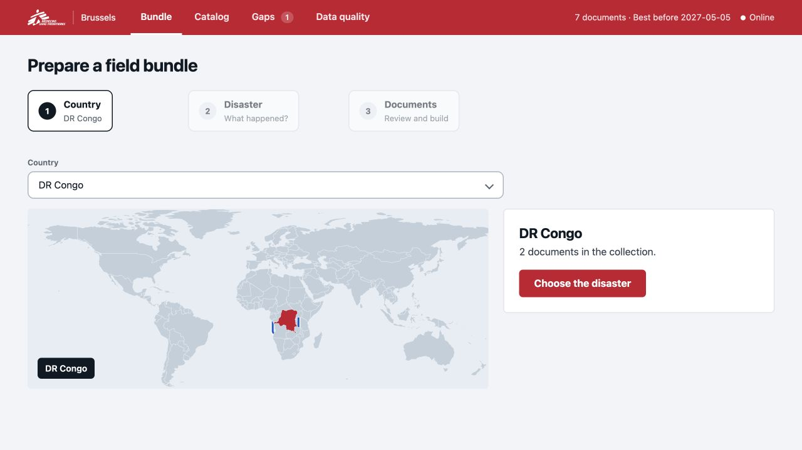
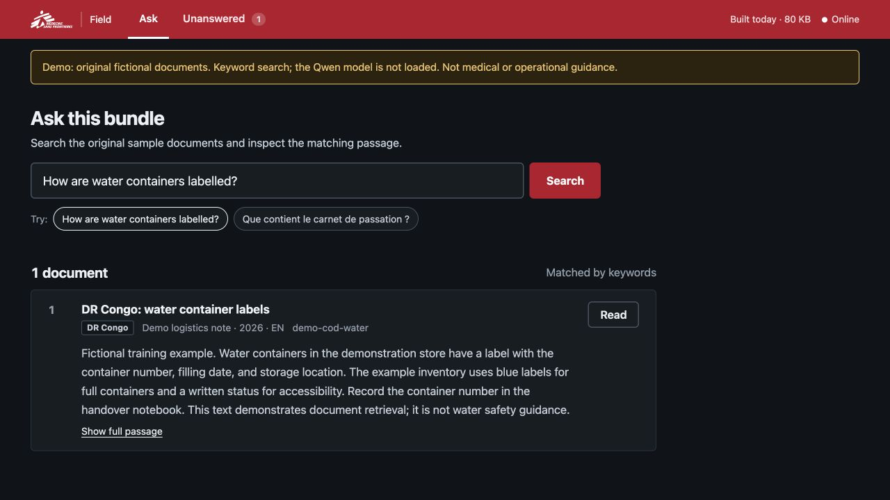

# Response Bundle

[](https://github.com/aminezar/d4gc/actions/workflows/ci.yml)

Offline document search for humanitarian field teams. Built in four hours for the **MSF challenge**, winner of **Best Overall at the Data 4 Good Challenge**, Leuven, 28 October 2026.

Office staff select the documents a country team needs and export them as one SQLite file. The field team searches that file on a laptop, without internet, and reads matching passages with their source, year and language. The system retrieves document text rather than writing answers. When the evidence is weak, it returns **“Not in this collection.”**

[See the project](https://aminezar.github.io/d4gc/) · [How it works](#how-it-works) · [Evaluation](eval/RESULTS.md)

| Brussels: prepare a bundle | Field: search the documents |
|---|---|
|  |  |

## Try it

Requires **Python 3.11+** and [uv](https://docs.astral.sh/uv/).

```sh
git clone https://github.com/aminezar/d4gc.git
cd d4gc
uv sync --frozen
uv run python -m pipeline.demo
uv run python app/server.py --bundle bundles/demo.sqlite
```

Open **[Brussels](http://127.0.0.1:8000/brussels)** or **[Field](http://127.0.0.1:8000/field)**. Try “How are water containers labelled?” or “Que contient le carnet de passation ?”.

The sample contains seven fictional documents in four languages and one missing-file record to demonstrate the quality report. It uses keyword search, so no model download is needed. The MSF challenge dataset is not included.

To try semantic search on the same sample:

```sh
uv run python -m pipeline.demo --semantic --out bundles/demo-semantic.sqlite
uv run python app/server.py --bundle bundles/demo-semantic.sqlite
```

This downloads Qwen3-Embedding-0.6B once, approximately 1.2 GB. The float32 runtime needs about 4 GB of RAM. Once dependencies and model weights are cached, set `HF_HUB_OFFLINE=1` to run without contacting the model host.

## How it works

```text
Source documents → clean, tag and embed → full collection
                                              ↓ select country and documents
                                         country.sqlite
                                              ↓ transfer to a laptop
                                         local search → source passages or refusal
```

- **Prepare in Brussels.** Clean text, remove duplicates, split passages, tag countries and crisis types, and create embeddings.
- **Build a bundle.** Select a country, review its documents and global guidance, then download a SQLite file. Export copies the existing passages and vectors without re-embedding.
- **Search in the field.** Combine semantic similarity with SQLite FTS5 keyword search using reciprocal rank fusion. Show up to five passages, with at most two per document, or refuse when both retrieval signals are weak.

The bundle contains text, metadata, vectors and a search index. Original PDF/HTML files and model weights are separate. Unanswered questions are saved in `gaps.jsonl`; teams transfer that file back to Brussels manually.

To run an exported sample bundle separately:

```sh
uv run python -m pipeline.export "DR Congo" --full bundles/demo.sqlite --out bundles/demo-cod.sqlite
uv run python app/server.py --bundle bundles/demo-cod.sqlite --port 8001
```

See [the app guide](app/README.md) for routes and server options, and [the pipeline guide](pipeline/README.md) for processing a document collection and the SQLite schema.

## Results and limitations

On 21 held-out questions, hybrid search retrieved an expected document for **9/9 answerable questions** and correctly refused **9/12 unanswerable questions**. Three unsupported questions still received results. See [the evaluation](eval/RESULTS.md) for the method, baseline and environment.

This is a hackathon prototype, not a clinically validated tool. Matches can be irrelevant or outdated, cross-language questions can be missed, and country tags can be wrong. The local server has no authentication or automatic synchronization. Keep it on its default loopback address; see [security and query handling](SECURITY.md).

## Development

```sh
uv sync --frozen
uv run pytest -q
```

CI runs on Python 3.11 and 3.13. Four tests require the challenge dataset and skip when it is absent.

The website is plain HTML/CSS in `docs/`. Preview it with `python -m http.server 8766 --directory docs`. GitHub Pages publishes this directory from `main`.

| Directory | Contents |
|---|---|
| [pipeline/](pipeline/README.md) | Cleaning, tagging, embeddings, sample data builder and bundle export |
| [search/](search/__init__.py) | Hybrid retrieval and refusal logic |
| [app/](app/README.md) | FastAPI server and both interfaces |
| [demo/](demo/documents.json) | Fictional sample documents |
| [eval/](eval/RESULTS.md) | Evaluation questions, results and thresholds |
| [tests/](tests/) | Unit and API tests |
| [docs/](docs/) | GitHub Pages project website |

## Team and license

Amine Zarouali, Ebubekir Kahriman and Inés Martinéz.

Code and sample content: [MIT](LICENSE). This is an independent project built for the MSF challenge, not an official MSF product. See [NOTICE.md](NOTICE.md) for third-party attribution.
